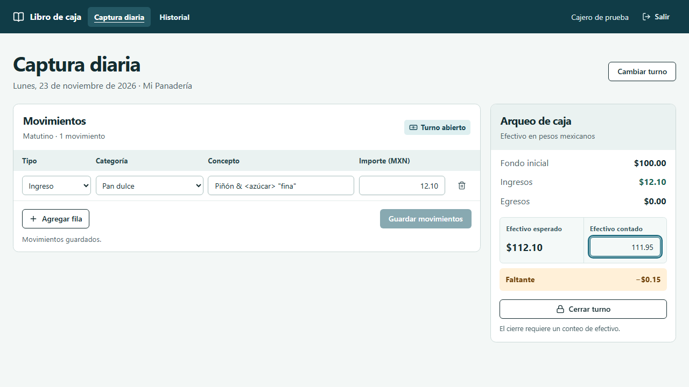
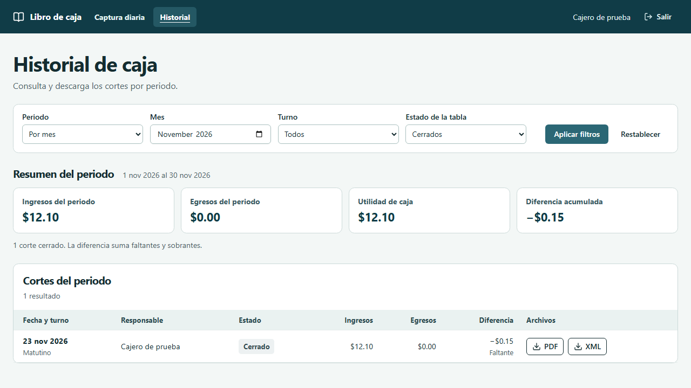

# Libro de caja para panadería

Aplicación web para reemplazar el cuaderno de caja de una panadería. El cajero puede abrir un turno, registrar movimientos en efectivo con el teclado, guardar su trabajo y comparar lo esperado con lo contado. El administrador puede revisar el historial y descargar los cortes cerrados.

**Estado:** MVP implementado y verificado con datos ficticios. Se probó el flujo de navegador, una instalación limpia en Docker y la restauración de un respaldo. No se ha desplegado en producción ni se ha validado en un turno real.

## Vista previa

**[Ver o descargar el recorrido en video (MP4, 24 segundos)](https://github.com/Nivi018/panaderia-libro-de-caja/releases/download/demo-portafolio/panaderia-recorrido.mp4).** Grabación de la aplicación en uso: apertura del turno, captura de una venta y un gasto, cierre con diferencia justificada y descarga de PDF y XML. La grabación usa datos ficticios.

Datos ficticios generados por la prueba de navegador en una base temporal.

| Captura y arqueo | Historial |
| --- | --- |
|  |  |

## Decisiones del proyecto

- **El efectivo se calcula al centavo.** PostgreSQL almacena `numeric(12,2)`; la API comparte cadenas decimales y el dominio suma centavos con `bigint`. El MVP excluye tarjetas y transferencias.
- **Un cierre no se puede editar.** El servidor comprueba permisos, estado y versión en una transacción antes de guardar o cerrar. Un guardado simultáneo no sobrescribe un cambio anterior.
- **Una falla de guardado no borra la captura.** React Hook Form maneja las filas; Zustand conserva el borrador en la sesión del navegador; TanStack Query actualiza y revierte la caché según la respuesta de la API.
- **Los archivos usan el corte guardado.** El PDF y el XML se generan desde el detalle oficial del corte cerrado. El resumen mensual considera todos los cortes cerrados que coinciden con el periodo, no solo la página visible.

**Stack:** React, TypeScript, Vite, Tailwind y shadcn/ui · Node.js, Hono RPC, Better Auth y Zod · PostgreSQL 16, Drizzle y Docker Compose · Playwright y GitHub Actions.

Consulta la [arquitectura y sus reglas](docs/arquitectura.md), el [plan original](PLAN.md) o la [guía de instalación](IMPLEMENTACION.md). El proyecto no pretende sustituir un sistema de punto de venta, inventario ni facturación.

## Diseño en OpenCode

La skill oficial `impeccable` se usó para preparar la interfaz. El contexto de producto está en [`client/PRODUCT.md`](client/PRODUCT.md) y el sistema visual en [`client/DESIGN.md`](client/DESIGN.md). La skill es una herramienta de autoría opcional, no un requisito de la aplicación; sus archivos de terceros no se versionan aquí. Para instalar la versión usada en OpenCode, sin hooks automáticos:

```sh
npx impeccable@4.10.0 install --providers=opencode --scope=project --no-hooks --yes
```

## Desarrollo local

Requiere Node.js 22.13+ en la rama 22 o Node.js 24+, npm y Docker Compose v2.24.4+ (incluidas las versiones posteriores). En Windows, usa `npm.cmd` si PowerShell bloquea `npm.ps1`.

```sh
npm ci
npm run setup:env
docker compose -f docker-compose.yml -f compose.local.yml up -d --wait db
npm run db:migrate
npm run db:seed
npm run dev
```

- La SPA usa `http://127.0.0.1:5174`. Vite reenvía `/api` a Hono (`127.0.0.1:3000`). La API publica `GET /healthz` para comprobar el proceso y `GET /readyz` para comprobar PostgreSQL y las tablas del esquema. `GET /api/me` consulta el usuario autenticado y `/api/ledgers` gestiona la captura. Si cambias `WEB_PORT`, ajusta `BETTER_AUTH_URL` para que coincida con el origen que abrirás.
- La base solo se publica en localhost (`55432`); si necesitas cambiar el puerto, ajusta `POSTGRES_PORT` y `DATABASE_URL` en `.env`.
- `setup:env` genera credenciales de desarrollo sin imprimirlas ni sobrescribir archivos existentes. El correo inicial es `admin@panaderia.local`; consulta `SEED_ADMIN_PASSWORD` en tu `.env` local. El seed repetido no cambia usuarios existentes ni escala sus permisos. No reutilices esos valores en producción.
- Para generar SQL después de cambiar [el esquema](server/src/db/schema.ts), ejecuta `npm run db:generate` y revisa los archivos de `server/drizzle/` antes de aplicar `npm run db:migrate`. Las migraciones deben conservarse con el código.

### Historial y datos para probar

En **Historial** (`/historial`), el cajero y el administrador pueden filtrar por mes o rango, turno y estado. Los indicadores incluyen solo cortes cerrados del periodo y turno elegidos; el filtro de estado solo afecta la tabla. La diferencia acumulada suma faltantes y sobrantes con su signo. Los cortes abiertos no muestran importes ni botones de descarga.

Las descargas usan los datos de un corte cerrado consultados en la API. El PDF incluye el arqueo y la línea de firma; el XML UTF-8 usa cadenas decimales y la raíz `LibroContable`.

Para probar con cinco días de ejemplo, ejecuta en una **base local de desarrollo** ya migrada:

```sh
npm run db:seed
npm run db:seed:demo -- --confirm-demo
```

El seed agrega cortes cuadrados, un faltante, un sobrante y un turno abierto. No sobrescribe cortes existentes ni se ejecuta en producción.

## Piloto y cuentas de caja

Sigue la [guía del piloto](PILOTO.md) para operar un turno real en paralelo con el papel. Para dar de alta a un cajero, prepara `CASHIER_EMAIL`, `CASHIER_NAME` y `CASHIER_PASSWORD` en el entorno de la terminal del operador. Usa una contraseña única de 12 a 128 caracteres. No la escribas como argumento, en el historial de la terminal ni en `.env`. El comando no cambia cuentas existentes.

```sh
npm run users:create-cashier
```

En PowerShell puedes leer la contraseña sin mostrarla en pantalla y retirarla del entorno al terminar:

```powershell
$env:CASHIER_EMAIL = Read-Host 'Correo del cajero'
$env:CASHIER_NAME = Read-Host 'Nombre del cajero'
$secret = Read-Host 'Contraseña del cajero' -AsSecureString
$env:CASHIER_PASSWORD = [Net.NetworkCredential]::new('', $secret).Password
try { npm.cmd run users:create-cashier }
finally { Remove-Item Env:CASHIER_PASSWORD -ErrorAction SilentlyContinue; $secret.Dispose() }
```

Si el servidor está en contenedores, conserva las variables de la terminal y usa los mismos archivos de Compose y `.env` de ese entorno. En desarrollo Docker, sustituye `node server/dist/create-cashier.js` por `npm run users:create-cashier`.

```sh
docker compose --env-file .env.production -f docker-compose.yml -f compose.prod.yml run --rm -e CASHIER_EMAIL -e CASHIER_NAME -e CASHIER_PASSWORD app node server/dist/create-cashier.js
```

## Ejecución en Docker

Con `.env` configurado, `docker compose --profile app up --build --watch` ejecuta el modo de desarrollo completo (base privada, migración y app). Si se toca un manifiesto de dependencias, actualiza el lockfile con `npm install`.

Si HTTPS pasa por un proxy o antivirus corporativo y Docker no confía en su certificado, copia una CA PEM que ya sea de confianza en tu equipo a `.certs/npm-ca.pem`, define `NPM_CA_FILE=./.certs/npm-ca.pem` y añade `-f compose.ca.yml` a los archivos de Compose. `.certs/` se excluye de Git y del contexto de build. El certificado se monta solo durante `npm ci`; no se copia a la imagen ni se desactiva la verificación TLS.

Para producción, usa un `.env` de despliegue con credenciales propias y `BETTER_AUTH_URL` apuntando al origen público HTTPS. Configura un proxy inverso con TLS hacia `127.0.0.1:18080` (o ajusta `APP_PORT`).

```sh
docker compose --env-file .env.production -f docker-compose.yml -f compose.prod.yml --profile app up -d --build --wait
docker compose --env-file .env.production -f docker-compose.yml -f compose.prod.yml --profile app ps -a
```

Compose inicia PostgreSQL en una red privada y ejecuta la migración antes de levantar la app. Para provisionar el admin, inyecta `SEED_ADMIN_PASSWORD` temporalmente al entorno de la terminal y, desde el mismo despliegue, ejecuta:

```sh
docker compose --env-file .env.production -f docker-compose.yml -f compose.prod.yml run --rm -e SEED_ADMIN_PASSWORD app node server/dist/seed-admin.js
```

No ejecutes `docker compose down -v` si quieres conservar los datos: eliminaría el volumen de PostgreSQL. El volumen permite persistencia, pero no sustituye un respaldo.

## Verificación

```sh
npm run typecheck
npm run lint
npm test
npm run test:db
npm run build
npm audit --omit=dev
```

`test:db` requiere una base local ya migrada y verifica restricciones, dinero exacto y sesiones contra PostgreSQL real. El manifiesto raíz fija dos dependencias transitivas de herramientas de desarrollo para cubrir avisos de npm; revisa si siguen siendo necesarias al actualizar Drizzle Kit o shadcn.

### Prueba de navegador

```sh
npx playwright install chromium
npm run build
npm run test:e2e
```

`test:e2e` requiere que el usuario de PostgreSQL local pueda crear bases. Crea y elimina una base con nombre aleatorio, usa los puertos `13000` y `15174`, y no modifica el libro habitual. Verifica el alta de un cajero, que un correo duplicado no cambia su acceso, sesión, borrador tras recarga y error de guardado, corte con diferencia, historial y descargas reales. GitHub Actions también ejecuta esta prueba.

## Respaldo y restauración

Haz un respaldo antes de actualizar y según la frecuencia de captura. Un PDF o XML no sustituye el respaldo de PostgreSQL. Ejecuta los comandos desde la raíz y usa el mismo conjunto de archivos/env de Compose del despliegue cuando corresponda.

```sh
docker compose exec -T db sh -c 'umask 077; pg_dump -U "$POSTGRES_USER" -d "$POSTGRES_DB" -Fc -f /tmp/panaderia.dump'
docker compose cp db:/tmp/panaderia.dump ./panaderia.dump
docker compose exec -T db rm /tmp/panaderia.dump
```

Guarda el archivo con acceso restringido y fuera del equipo que aloja la base. Contiene datos del libro y credenciales derivadas de usuarios. Guarda la configuración del despliegue por separado y de forma segura. Evita subir el respaldo al repositorio. Se usa `compose cp` para conservar el binario también en Windows.

Para verificar el respaldo, restaura **a una base nueva**. Si `panaderia_restore_check` ya existe, escoge otro nombre antes de ejecutar los pasos. Detente ante cualquier error.

```sh
docker compose exec -T db sh -c 'createdb -U "$POSTGRES_USER" panaderia_restore_check'
docker compose cp ./panaderia.dump db:/tmp/panaderia-restore.dump
docker compose exec -T db sh -c 'pg_restore --exit-on-error --single-transaction --no-owner -U "$POSTGRES_USER" -d panaderia_restore_check /tmp/panaderia-restore.dump'
docker compose exec -T db sh -c 'psql -v ON_ERROR_STOP=1 -U "$POSTGRES_USER" -d panaderia_restore_check -c "SELECT date, shift, status FROM daily_ledgers ORDER BY date DESC LIMIT 5;"'
docker compose exec -T db rm /tmp/panaderia-restore.dump
```

Compara los cortes recuperados con el historial antes de considerar válido el respaldo. Una restauración de producción requiere una ventana de mantenimiento y cambiar la conexión a la base restaurada solo después de validarla; no uses `pg_restore --clean` sobre la base habitual.
