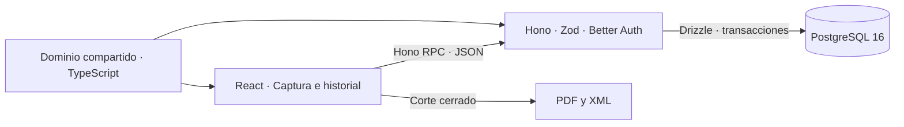

# Arquitectura del libro de caja

El MVP registra **una panadería, una moneda (MXN) y efectivo únicamente**. Está organizado en tres workspaces:

| Workspace | Responsabilidad |
| --- | --- |
| [`client`](../client) | SPA React/Vite; acceso, captura por filas, arqueo, historial y exportación. |
| [`server`](../server) | API Hono, sesiones Better Auth, autorización, transacciones, migraciones y agregados SQL. |
| [`packages/domain`](../packages/domain) | Esquemas Zod compartidos, categorías, validación de importes y aritmética exacta. |

El cliente consume Hono con `hc<AppType>` importado como tipo y TanStack Query. Los errores HTTP y los esquemas de entrada son parte del contrato. En desarrollo Vite reenvía `/api`; en producción Hono sirve la SPA compilada y la API desde el mismo origen que publica el proxy HTTPS.

## Datos e integridad

- [`daily_ledgers`](../server/src/db/schema.ts): fecha operativa, turno, fondo, efectivo contado, estado y responsable. La base garantiza un corte por fecha y turno.
- `ledger_entries`: movimientos vinculados al corte, con categoría, concepto, importe y orden de captura. El importe debe ser positivo.
- `user`, `session`, `account`, `verification`: autenticación y roles de Better Auth. No hay registro público; el alta es una operación administrativa.
- Los importes viajan como cadenas decimales. El cálculo de un corte usa `bigint` en centavos; los acumulados se calculan con `numeric` en PostgreSQL.
- Los cambios del corte comprueban la versión bajo bloqueo transaccional. El cajero puede editar sus cortes abiertos y el administrador, cualquier corte abierto. Los cortes cerrados son de solo lectura.
- `esperado = fondo + ingresos − egresos`; `diferencia = contado − esperado`. Un conteo de cero es válido; si hay diferencia al cerrar, se requiere una explicación.

## API principal

| Ruta | Uso |
| --- | --- |
| `GET /healthz`, `GET /readyz` | Disponibilidad del proceso y comprobación de base/esquema. |
| `GET/POST /api/auth/*`, `GET /api/me` | Inicio y cierre de sesión; identidad autenticada. |
| `GET /api/ledgers/today`, `POST /api/ledgers` | Consultar turnos de hoy y abrir un corte. |
| `GET /api/ledgers/:id`, `PUT /api/ledgers/:id/entries`, `POST /api/ledgers/:id/close` | Consultar, guardar movimientos en lote y cerrar. |
| `GET /api/ledgers`, `GET /api/ledgers/summary` | Historial paginado y totales del periodo. |

## Verificación y límites

La automatización incluye pruebas unitarias de dinero, integración con PostgreSQL, autenticación, permisos, concurrencia y un flujo de Chromium que usa una base temporal: apertura, recuperación de borrador, cierre e inspección de PDF/XML. La [guía de instalación](../IMPLEMENTACION.md) distingue estas pruebas de las verificaciones del sitio definitivo.

El MVP no incluye reapertura de cortes, correcciones contables posteriores al cierre, cobros no efectivos, inventario, facturación ni múltiples sucursales.
